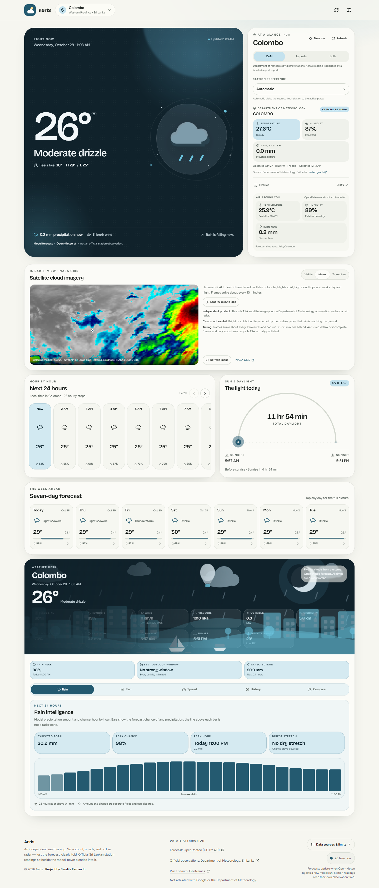
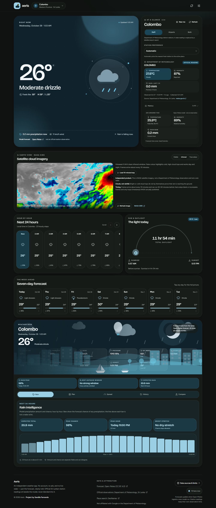
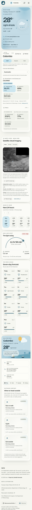
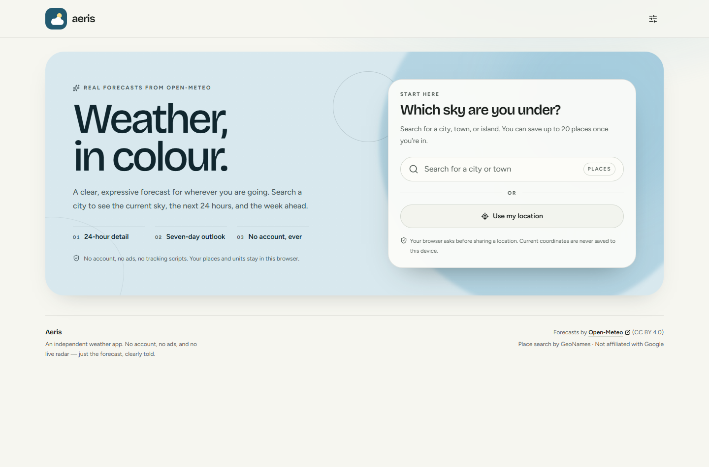

# Aeris

Aeris is a responsive, Material 3 Expressive-inspired weather dashboard built with Next.js, React, Tailwind CSS, live forecasts from [Open-Meteo](https://open-meteo.com/), and current station observations from the Sri Lanka Department of Meteorology (DoM). When the DoM page is unreachable from the deployment region, Aeris shows clearly labelled official airport METAR reports from NOAA AWC instead of inventing or hiding data. Search for a city or use browser geolocation to see current conditions, the next 24 hours, and a seven-day outlook. Saved places, preferences, and the installed app stay on your device. No account, API key, database, or analytics are involved.



## Highlights

- **Current conditions** — temperature, feels-like temperature, daily high/low, condition, precipitation, wind, humidity, pressure, visibility, cloud cover, and UV, with an animated condition illustration.
- **Sri Lankan station observations** — the DoM station nearest the selected place, shown beside the forecast with separate attribution, observation time, relative freshness, and explicit stale, missing, and unavailable states. If the DoM page cannot be reached, the card switches to official NOAA AWC airport METAR reports and says so; it never relabels airport data as DoM district data.
- **Station selection** — automatic selection prefers a fresh usable observation over a nearer stale one. A manual choice is saved, shared between the dashboard and Preferences, and never silently replaced.
- **Hourly forecast** — 24 hourly steps with condition, temperature, and precipitation probability.
- **Seven-day outlook** — daily high/low ranges, conditions, rain chance, and a detail dialog with sunrise, sunset, UV, wind, and precipitation.
- **Weather Desk** — Plan, Rain, Spread, Compare, and History tools for the active place, with model spread labelled as a model rather than an observation.
- **Place search** — debounced Open-Meteo geocoding with keyboard navigation, empty states, and retry handling.
- **Browser geolocation** — optional current-position forecast that stays session-only.
- **Saved places** — up to 20 locations, persisted in `localStorage`, with switching and removal.
- **Preferences** — Celsius/Fahrenheit, km/h, mph, or m/s, light, dark, and system themes, reduced effects, and the saved station.
- **Resilient states** — loading skeletons, retryable errors, stale-forecast notices, offline messaging, automatic refresh, and refresh-on-reconnect.
- **Installable PWA** — a production service worker caches the app shell for offline launches, serves a dedicated offline page, and never caches weather API responses.
- **Responsive and accessible** — layouts verified from 360 px through 1440 px, keyboard-friendly controls, reduced-motion support, and automated WCAG 2.2 AA checks.

### Desktop, dark, and mobile

| Dark | Mobile |
| --- | --- |
|  |  |

The onboarding screen is shown before a first place is chosen:



## Stack

- **Framework:** Next.js 16.4 (App Router, Cache Components, one route handler)
- **UI:** React 19, Tailwind CSS 4, shadcn/ui primitives built on Radix UI, Lucide icons
- **Motion:** Motion for React and CSS animations, with reduced-motion handling
- **Data:** Open-Meteo Forecast, Ensemble, Archive, and Geocoding APIs; Sri Lanka Department of Meteorology station observations; NOAA Aviation Weather Center ICAO METAR fallback
- **Offline:** Hand-written service worker and web app manifest
- **Testing:** Node's built-in test runner, Playwright, axe-core
- **Language:** JavaScript (JSX), no TypeScript
- **Deployment targets:** Vercel and Netlify (no environment variables required)

## Getting started

Requires Node.js 20.9 or newer and npm 10 or newer.

```bash
npm install
npm run dev
```

Open [http://localhost:3000](http://localhost:3000). Forecast, ensemble, archive, and search requests go directly from the browser to Open-Meteo. DoM observations are read by a same-origin route handler because `meteo.gov.lk` does not allow cross-origin browser requests. If the DoM host is unreachable from the deployment region, the same route falls back to NOAA AWC ICAO METAR reports and labels them as airport stations. There is no `.env` file and no key to configure.

Optional server environment variables for official observations:

| Variable | Purpose |
| --- | --- |
| `AERIS_OFFICIAL_SOURCE` | `auto` (default), `dom` to require DoM, or `metar` to skip DoM |
| `AERIS_DOM_PROXY_URL` | Private relay that returns the DoM station HTML when the public host blocks cloud egress |
| `AERIS_DOM_TIMEOUT_MS` | DoM request budget; defaults to 2.5 s on serverless platforms and 4 s elsewhere |
| `AERIS_METAR_TIMEOUT_MS` | NOAA AWC fallback budget; defaults to 8 s |

None of these are required for a normal deployment. The relay is optional and must not rewrite or invent observations.

The service worker is registered only in a production build. Use `npm run build && npm run start` to exercise install and offline behavior; the dev server intentionally runs without it so stale caches cannot mask local changes.

## Scripts

| Command | Purpose |
| --- | --- |
| `npm run dev` | Start the Turbopack development server |
| `npm run build` | Create an optimized production build |
| `npm run start` | Serve the production build |
| `npm run lint` | Run ESLint across the project |
| `npm run test:unit` | Run Node unit tests for weather, storage, formatting, palettes, station selection, the DoM parser, cache behavior, and presence parsing |
| `npm run test:e2e` | Build, start the production server, and run all Playwright tests |
| `PW_DEV=1 npm run test:e2e` | Run Playwright against an existing dev server |

In PowerShell, set the development-server flag for the current shell with:

```powershell
$env:PW_DEV = "1"
npm run test:e2e
```

Playwright uses the installed Chrome channel by default. If Chrome is unavailable, install Playwright's bundled browser and set `PW_BUNDLED=1`:

```bash
npx playwright install chromium
PW_BUNDLED=1 npm run test:e2e
```

## Testing

The suite covers:

- **43 unit tests** for condition mapping, forecast normalization, URL construction, unit conversion, time formatting, storage sanitization, palette resolution, DoM HTML parsing, station selection and freshness ranking, cached-fetch fallback, METAR normalization, the DoM-to-METAR orchestrator, and presence parsing.
- **28 Playwright tests** for onboarding, keyboard search, forecast rendering, station selection and persistence, stale and unavailable observation states, the labelled NOAA AWC fallback, Weather Desk tools, refresh success and failure, saved-place management, preference persistence, initial errors, offline recovery, geolocation, empty search, responsive overflow, daily-card reflow, and production service-worker caching and offline boot.
- **Accessibility scans** with axe-core on the onboarding screen, light and dark dashboards, day-detail dialog, preferences dialog, and location dialog. No automated WCAG 2.2 A/AA violations were found in the tested surfaces.

Playwright intercepts Open-Meteo and the DoM route with deterministic fixtures so runs do not depend on live conditions. Observation fixtures are aged relative to the browser clock, so freshness and stale behavior can be tested at any time. Screenshots saved during the responsive run are written to `test-results/screenshots/`; selected production screenshots are checked in under `docs/screenshots/`.

These are automated checks, not a substitute for a manual screen-reader and assistive-technology audit.

## Architecture

```text
src/
  app/                 Next.js app shell, metadata, global styles, icon
  app/api/weather/     Same-origin route handler for DoM observations
  components/          Dashboard, station card, Weather Desk, dialogs, UI primitives
  hooks/               Weather loading, station source, city search, presence, PWA
  lib/                 API normalization, storage, station selection, formatting,
                       palettes, DoM/METAR source adapters, cache helpers
public/
  sw.js                App-shell service worker (production only)
  offline.html         Offline fallback page
  icons/               PWA and platform icons
netlify.toml           Netlify Next.js build output and adapter settings
vercel.json            Vercel framework and function region
tests/
  unit/                Node test runner suites
  e2e/                 Playwright functional, station, axe, and responsive suites
  fixtures/            Deterministic Open-Meteo and DoM payloads
docs/screenshots/      Production screenshots used in this README
```

Key implementation details:

- `src/lib/weather.js` builds the Open-Meteo request and normalizes the response into a small, defensive view model. Missing optional fields become `null` and render as unavailable instead of breaking the page.
- `src/hooks/use-weather.js` deduplicates in-flight requests, keeps a 10-minute in-memory cache, enforces a 15-second request timeout, and preserves the previous forecast when a refresh fails.
- `src/components/weather-app.jsx` owns saved places, the active location, the shared DoM request, station preference, refresh scheduling, reconnect refresh, and the page-level loading/error/offline states.
- `src/app/api/weather/sri-lanka-dom/route.js` is a request-time Next.js route handler (not a static file). It calls the official-observation orchestrator, caches a successful response for five minutes, serves stale data for up to six hours with an explicit stale status, and returns JSON with a 503 status when both official sources fail. It never returns HTML, so the browser's JSON client cannot receive a Netlify not-found page.
- `src/lib/sources/official-observations.js` keeps DoM as the primary source, applies a bounded request budget, and falls back to NOAA AWC METAR only when DoM cannot be reached or parsed. The response records `fallback.active`, the primary error code, and safe attempt diagnostics. The two datasets are never merged.
- `src/lib/sources/metar.js` normalizes ICAO METAR reports from six Sri Lankan airport stations, maps them to the same station model, and deliberately leaves rainfall unavailable because METAR does not carry a rainfall total.
- `src/lib/station-selection.js` contains the automatic and manual station rules: Sri Lanka detection, approximate distance, freshness and usability checks, and the unavailable-manual fallback.
- `src/components/official-observations.jsx` renders one station observation beside the primary forecast. The two sources are never averaged or blended, and each carries its own attribution and timestamp.
- Preferences and places persist under `aeris:preferences:v1` and `aeris:places:v1`. Coordinates are rounded to three decimal places before storage and API use. `stationId` defaults to `"auto"`.
- Each weather condition family has a light and dark palette. Palette values are exposed as CSS variables on the document root, including separate day and night hero treatments.
- The theme and reduced-effects flag are initialized by a small inline script before hydration to avoid a flash. `useNow()` intentionally starts at zero so Cache Components can prerender without reading the current time.
- Dialogs use Radix primitives for focus trapping, Escape handling, and restoration. Motion animations are disabled when the user prefers reduced motion or enables **Reduce effects**.
- `public/sw.js` caches only stable same-origin shell assets plus the hashed CSS, JS, and fonts referenced by the cached document. It bypasses `/api/*`, Next.js data and image routes, third-party origins, and non-GET requests, and is versioned so an update replaces the previous cache.

## Data and privacy

- Forecasts, hourly data, and current conditions come from the Open-Meteo Forecast API. Place search uses the Open-Meteo Geocoding API, which is based on GeoNames data. Weather Desk's spread and history tools use Open-Meteo's ensemble and archive APIs.
- Current station observations come first from the [Sri Lanka Department of Meteorology](https://meteo.gov.lk/). The browser calls Aeris's own `/api/weather/sri-lanka-dom` route, which retrieves and parses the public DoM homepage. That route takes no parameters, so no place name, coordinates, saved place, or preference is sent with it. If DoM is unreachable from the deployment region, the route fetches official ICAO METAR reports from the [NOAA Aviation Weather Center](https://aviationweather.gov/data/api/) and marks them as airport observations, not DoM district stations.
- Forecast, search, ensemble, and archive requests go directly from the browser to Open-Meteo. Aeris has no database, accounts, analytics, advertising, or tracking scripts.
- The footer's best-effort “here now” count exchanges a random per-tab ID and a timestamp through the public [ntfy.sh](https://ntfy.sh/) relay. The topic is public: never treat the count as authenticated or private. No account, location, or personal data is sent. If the relay is blocked or rate-limited, the chip reports that the count is unavailable instead of guessing.
- Saved places and preferences remain in this browser's `localStorage`. The current-location forecast is held in memory for the session and is not saved. Current coordinates are rounded before use.
- A production service worker caches the app shell and stable static assets. It does not cache `/api` routes or weather responses, so a fresh reload still needs the network for live data.
- Open-Meteo data is provided under [CC BY 4.0](https://creativecommons.org/licenses/by/4.0/). Open-Meteo, DoM, and NOAA AWC attribution is shown in the app. Aeris is not affiliated with Google, Open-Meteo, the Department of Meteorology, or NOAA.
- Weather data is informational. Aeris does not display official warnings, and nothing here is a substitute for government-issued severe-weather guidance or emergency instructions.

## Known limitations

- **No radar.** Consumer radar tile services have restrictive licensing and attribution requirements, so a radar layer was deliberately left out rather than simulated.
- **No official bulletins or advisories.** The app shows forecast conditions and DoM station observations, not government-issued warnings. Check the Department of Meteorology directly for official alerts.
- **Approximate station locations.** DoM does not publish station coordinates on the page Aeris reads. Distance and automatic selection for DoM therefore use documented approximate city-centre reference points, labelled in the interface as Aeris reference points rather than official station coordinates. NOAA AWC fallback stations do publish airport coordinates.
- **Automatic selection is Sri Lanka only.** Outside Sri Lanka the card explains that there is no automatic match, while a manual station can still be chosen.
- **DoM parsing can break.** Observations are read from an HTML page with no documented API. If the markup changes, Aeris shows the fallback or an unavailable state rather than inventing a reading.
- **DoM network reachability varies by region.** `meteo.gov.lk` succeeds from some local and Sri Lankan networks but times out from many public cloud regions, including regions used by Vercel and Netlify. This is an upstream network restriction, not a parser or CORS failure. Aeris bounds the attempt, optionally supports a private DoM HTML relay, and otherwise shows the labelled NOAA AWC fallback.
- **The NOAA fallback is not DoM district data.** It contains official ICAO airport reports, not Department of Meteorology district stations, and METAR does not include a rainfall total. Depending on reporting, only a subset of the six configured airports may appear. The interface always names the active source.
- **Offline shell only.** The installed app can launch from cache, but live forecasts and station observations still require a network connection.
- **No reverse geocoding.** Browser coordinates are labelled “Current location” rather than resolved to a street address or city name.
- **Live-service dependency.** Search, forecasts, and station observations require Open-Meteo, DoM, and/or NOAA AWC to be reachable and are subject to their availability, CORS policy, and rate limits. The presence count additionally depends on ntfy.sh.
- **Local-only personal data.** Clearing browser storage removes saved places and preferences. Saved places do not sync across devices.
- **Automated accessibility only.** Automated axe scans pass, but a manual screen-reader audit has not been performed.

## Deployment

Aeris is a Next.js application with one request-time route handler. It needs a platform that runs the Next.js server output, not a static file host. Both Netlify and Vercel detect the framework automatically and need no environment variables.

### Netlify

`netlify.toml` sets the build command to `npm run build` and the publish directory to `.next`. Netlify's zero-config OpenNext adapter picks up Next.js from `package.json` and turns that output into the site and its functions. Do not install or pin `@netlify/plugin-nextjs` manually.

1. Push the repository to GitHub, GitLab, or Bitbucket.
2. In Netlify, choose **Add new site → Import an existing project** and select the repository.
3. Check the build settings before the first deploy:
   - **Base directory:** leave empty when the repository root is the app root. If the app lives in a subdirectory, set that subdirectory, not `src`.
   - **Build command:** `npm run build`
   - **Publish directory:** `.next`
4. Remove any old publish directory (`out`, `dist`, `build`, or the repository root) and any catch-all redirect such as `/* /index.html 200` from the Netlify UI. Those overrides make the site serve a static file instead of the Next.js output, which is what produces a “Page not found” page.
5. Deploy, then open the deploy log and confirm the Next.js adapter ran and the route list includes `/` and `/api/weather/sri-lanka-dom`.
6. Test the deployed site:
   - `/` returns the dashboard HTML.
   - `/api/weather/sri-lanka-dom` returns JSON, not HTML. A `200` means an official source responded; a `503` with a `status: "unavailable"` JSON body means both official sources were unreachable, which is an honest failure rather than a missing page.

The site is statically prerendered except for the official-observation route, which runs on demand. Netlify's synchronous function timeout is short on some plans, so the route gives the DoM host a 2.5-second budget on serverless and then falls back to NOAA AWC METAR. If the deploy log shows the function timing out before either source answers, raise `AERIS_METAR_TIMEOUT_MS` only after checking the plan's function limit.

### Vercel

`vercel.json` sets the framework to `nextjs` and the function region to Singapore (`sin1`), which is closer to Sri Lanka than the default US region.

1. Push the repository to GitHub, GitLab, or Bitbucket.
2. Import the repository at [vercel.com/new](https://vercel.com/new) and keep the detected framework preset as **Next.js**.
3. Use the default build command and output settings, then deploy.
4. After authenticating with `npx vercel login`, the CLI equivalent is:

```bash
npx vercel --prod
```

Do not set a static output directory on either platform. The page is written to `.next/server/app/index.html` and needs the framework adapter; a static host pointed at `.next` without that adapter will show a not-found page.

A production URL is only real after the project is connected to an authenticated Netlify or Vercel account. This repository does not contain a deployment URL, and none is invented here.
